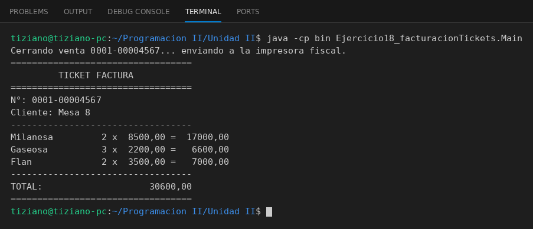

# ImpresoraFiscal

Programación II - Unidad 2 - Ejercicio 18

## Consigna
La caja registradora envía una Factura completa a la impresora fiscal para que la formatee e imprima.

## Lógica
- `ItemFactura` (descripción, cantidad, precio unitario, subtotal) y `Factura` (número, cliente, lista de ítems y total).
- `ImpresoraFiscal.imprimirDocumento(Factura)`: arma el ticket con `printf`.
- `CajaRegistradora.cerrarVenta(Factura)`: rechaza ventas sin ítems y le pasa la factura a la impresora.
- `Main`: factura de tres ítems impresa por consola.

## Ejecución

